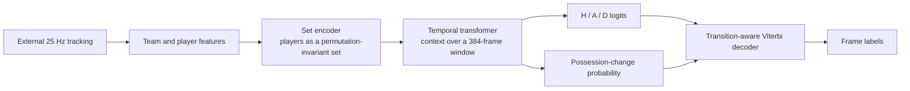

# More than a Hack 2027 · Possession Lab

Research code for frame-level football possession inference in the More than a Hack 2027 challenge. The project develops and compares models using eligible external tracking data, then packages a deterministic `frame,label` prediction pipeline for local use.

> **Competition boundary:** never train, tune, calibrate, rank, or select a model with the supplied match or its public five-minute labels. Never compare model output with the supplied video. Keep the licensed match assets, private reports, unreviewed checkpoints, and generated full-match predictions out of Git.

## Current approach

N013 is a set-temporal transformer with individual-player features and an auxiliary possession-change head. A transition-aware Viterbi decoder turns frame probabilities into smoother `H` (home), `A` (away), and `D` (dead-ball) sequences. `X` is reserved for abstentions in the submission contract. Later campaign records also report a decision to promote N018; the final submission model and its complete release package still need to be frozen.



### Features and why they were explored

- **Team context:** team width, forward movement, pressure, closing speed, and collective slowing can indicate control when the ball is missing. Earlier experiments found only small or condition-specific gains.
- **Individual and marking cues:** player-to-ball distance, identity-free role and marking relations, carrier pressure, and ball-touch evidence target short contested possessions the earlier models often missed. N010/N011 improved the clean-condition audit, though degraded tracking remained harder.
- **Transition head:** trained on external possession changes and decoded with a time-varying team-switch cost. This reduced false transitions and improved degraded-condition audit scores. N012 and the second seed N013 both cleared the pre-registered adoption criteria.
- **Pitch-control and graph relations:** time-to-intercept, team control, and pairwise spatial attention were tested as additional football structure. N014–N016 did not clear the full validation/adoption gate, so they were not added to the champion.
- **Latent-ball auxiliary task:** tested to improve robustness when the ball is hidden. The unbounded Gaussian loss destabilized N014; the bounded Huber variant N017 also failed the adoption gate.

## Recorded experiment evolution

Scores below are from the **three-match external development audit** (IDSSE and Metrica), not the challenge video or private full-match score. Clean and degraded columns are different tracking conditions. The run registry and decision log contain the hypotheses, validation gates, and limitations.

| Run | Main change | Clean spellF1 | Degraded spellF1 | Mean | Recorded decision |
|---|---|---:|---:|---:|---|
| N008 | Feature version 2, second seed | 0.640 | 0.571 | 0.605 | Prior champion |
| N010 | Individual, marking, pressure, and touch features | 0.705 | 0.569 | 0.637 | Adopted after seed confirmation |
| N011 | N010 seed confirmation | 0.697 | 0.572 | 0.635 | Champion checkpoint |
| N012 | Possession-change head and transition decoder | 0.715 | 0.593 | 0.654 | Adopted pending seed confirmation |
| **N013** | N012 second seed | **0.733** | 0.578 | **0.655** | Adopted at this stage |
| N014 | Pitch control + graph attention + Gaussian ball head | 0.610 | 0.477 | 0.543 | Rejected; auxiliary loss destabilized training |
| N015 | N014 without ball head | 0.732 | 0.577 | 0.654 | Not adopted; effectively neutral |
| N016 | Pitch control only | 0.734 | 0.593 | 0.663 | Not adopted; validation gate not met |
| N017 | Bounded latent-ball Huber head | 0.692 | 0.557 | 0.624 | Not adopted |
| E001 | Average N012 + N013 probabilities | 0.728 | 0.589 | 0.658 | Not adopted |
| N018 | Larger/longer transformer | 0.767 | 0.617 | 0.692 | Later promoted; second-seed confirmation was waived |

The audit is development evidence and must not be presented as independent full-match performance. The public five-minute scorer result for N013 is documented separately as a single-file correctness/alignment check only; it did not rank or select models. See the [experiment dashboard](experiments/dashboard.html) and [campaign status](experiments/research/neural/STATUS.md).

## Repository map

| Path | Contents |
|---|---|
| `src/possession_lab/` | Namespaced model, feature, data, and inference code |
| `src/possession_lab/io/` | ATD, homography, and Smart Tagging input helpers |
| `configs/` | Versioned baseline and neural experiment configurations |
| `scripts/` | Training, conversion, evaluation, diagnostics, and local quality tools |
| `tests/` | Synthetic unit and contract tests; no supplied-match labels as fixtures |
| `evaluation/` | Official metric implementation, validator, and scorer; keep unchanged |
| `official_documentation/` | Original challenge Markdown and starter material, preserved together |
| `experiments/` | Experiment protocol, dashboard, portfolio, and `research/` evidence |
| `data/` | Local licensed data location; an empty placeholder is tracked |
| `models/n018/` | Reviewed N018 checkpoint for inference |
| `artifacts/` | Local experimental checkpoints/reports; ignored by Git |

## Project pipeline

1. **Prepare data:** use external datasets only after recording source, licence, access terms, and provenance. Convert each provider to the canonical 25 Hz match representation.
2. **Split by match:** keep training, validation, and test matches disjoint; never split frames from one match across sets.
3. **Train:** run a versioned TOML config with a fixed seed. Record failed runs as well as successful ones; keep checkpoints and row-level data local.
4. **Select on external validation:** choose decoder parameters and candidate changes using the frozen external validation protocol and pre-registered gates.
5. **Audit externally:** report spellF1, macroF1, dead-ball and transition diagnostics, plus clean/degraded and provider transfer results where available.
6. **Infer locally:** apply a fixed model to the supplied input, validate CSV shape/alignment, and regenerate deterministically. Never use the challenge output/video to tune or review predictions.

## Getting started

Use Python 3.11 and the locked environment. The scorer itself only needs the dependencies documented in the official archive.

```powershell
uv sync --locked --group dev
uv run ruff check src tests scripts
uv run ruff format --check src tests scripts
uv run mypy src/possession_lab
uv run pylint src/possession_lab
```

For neural training, create an isolated Python 3.11 environment and install the matching PyTorch build and NumPy. For example, on a CUDA 12.8 Windows system:

```powershell
uv venv .venv-neural --python 3.11
uv pip install --python .venv-neural -r requirements-neural.txt --index-strategy unsafe-best-match --extra-index-url https://download.pytorch.org/whl/cu128
.venv-neural/Scripts/python -m pytest -q tests
```

Only use external datasets after licence and provenance review and a frozen experiment plan.

**Reproduction status:** N018 is the recorded champion. Its frozen decoder is in [`configs/neural/n018_decoder.json`](configs/neural/n018_decoder.json) and its reviewed checkpoint is in [`models/n018/best.pt`](models/n018/best.pt). The checkpoint's SHA-256 is `1b42d0f7eab232f6ba4ea2131d3f0a892f41f750504789dfcd5ce5edb5158a81`. The team has confirmed that the model may be shared for the competition. See the [release checklist](RELEASE_CHECKLIST.md).

With the authorized input bundle configured according to the [data documentation](official_documentation/DATA.md) and the neural environment installed, the intended local command is:

```powershell
.venv-neural/Scripts/python scripts/neural/predict_challenge.py --run n018_large_long --checkpoint models/n018/best.pt --decoder configs/neural/n018_decoder.json --device cuda --out artifacts/neural/submissions/n018.csv
```

For the Windows CUDA reproduction environment tested with Python 3.11.9, install
the fully pinned inference dependencies separately:

```powershell
uv venv .venv-inference --python 3.11.9
uv pip install --python .venv-inference -r requirements-inference-cu128.txt --index-strategy unsafe-best-match --extra-index-url https://download.pytorch.org/whl/cu128
.venv-inference/Scripts/python scripts/neural/predict_challenge.py --run n018_large_long --checkpoint models/n018/best.pt --decoder configs/neural/n018_decoder.json --device cuda --out artifacts/neural/submissions/n018.csv
```

On 2026-11-16, two local runs and a separate clean-checkout run with the pinned Windows CUDA environment passed the official validator and matched the recorded file SHA-256 `2d2e749920a659e456f6d9aaabfee0da6472c2185795c3c9c179b306fba229e2`. CUDA uses float16 and permits nondeterministic operations with warnings; different hardware or software may produce a different file. Verify the hash in the evaluator's environment. Checkpoints use PyTorch serialization and must come from a trusted source.

## Tests and quality evidence

- **2026-11-11:** 77 synthetic tests passed with the neural dependencies installed. Ruff lint and formatting passed, mypy reported no issues in 25 source files, and Pylint rated the package 10/10.
- The local baseline reproduction matched all 199,319 supplied baseline rows and passed the official format validator without reading ground truth.
- The public N013 scorer check is a correctness checkpoint only; it is not model-selection evidence.

## Documentation

- [Original challenge documentation](https://github.com/metrica-sports/more-than-a-hack-2027) · [archived starter material](official_documentation/starter/)
- [Competition rules](official_documentation/RULES.md) · [data contract](official_documentation/DATA.md) · [scoring](official_documentation/EVALUATION.md) · [submission format](official_documentation/SUBMISSION.md)
- [Experiment protocol](experiments/README.md) · [model portfolio](experiments/MODEL_PORTFOLIO.md) · [research registry](experiments/research/registry.md) · [decisions](experiments/research/decisions.md)
- [Technical document draft](TECHNICAL_DOCUMENT.md) · [release checklist](RELEASE_CHECKLIST.md)

The archived organizer documents retain their original text and upstream layout
references; some relative links in those archived files refer to the original
repository layout rather than this project's reorganized directories.

## Data and publication

The challenge assets are separately licensed and are not covered by the source-code licence. Match data and ground-truth samples are not distributed in this repository. Do not commit videos, generated tracking/tagging extracts, private labels, predictions, unreviewed checkpoints, or evaluation reports. Keep these under ignored local paths and review the applicable rights before publishing any derived result.

Third-party adaptations have their own terms; see [third-party notices](THIRD_PARTY_NOTICES.md), including the MPL-2.0 notice for the PathCRF adaptation. The organizer's original licence and files are preserved separately in the archive.
