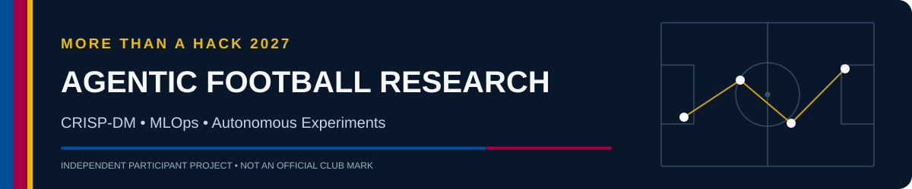

<p align="center">
  
</p>

# More than a Hack 2027 — Ball Possession

Independent team development repository for reproducible, frame-level football possession inference. The current implementation wraps the organizer's nearest-player baseline with validated configuration, deterministic CSV output, synthetic tests and local quality checks.

The competition is organized by [Metrica Sports](https://metrica-sports.com), [FC Barcelona](https://www.fcbarcelona.com) and [Mobile World Capital Barcelona](https://www.mwcbarcelona.com). This team repository is not an official organizer publication or an endorsement.

[Install](#install-on-windows) · [Local data](#add-the-authorized-data-locally) · [Run](#generate-and-validate-predictions) · [Checks](#engineering-checks) · [Rules](#competition-and-data-boundaries)

## What this project produces

A UTF-8 CSV with header `frame,label`, exactly **199,319** rows and consecutive tactical-video frames **0–199,318**. Labels are `H` (home possession), `A` (away possession), `D` (dead ball) and `X` (abstain). The reference recording is the tactical video at **25 fps**; the broadcast recording has its own timeline.

The competition ranks submissions by **spellF1**, with **macroF1** as the first tie-break. The organizer's published full-match reference for `baseline_smooth50` is spellF1 **0.2433** and macroF1 **0.6724**. Those are historical organizer benchmark results, not measurements of a new team model or access to private ground truth. See [EVALUATION.md](EVALUATION.md).

Our default configuration preserves the supplied baseline: nearest tracked player to the visible ball, followed by a centered majority vote with a **50-frame half-window**. It adds no manual corrections and does not learn from ground truth.

## Install on Windows

Use Windows 10/11, PowerShell, Git, [uv](https://docs.astral.sh/uv/getting-started/installation/) and Python **3.11**. Package metadata supports Python `>=3.11,<3.13`; use 3.11 for the documented environment. The core baseline needs NumPy and pandas, with no video decoder, GPU or API key.

This is a **private** repository. Authenticate Git with a GitHub account that has access before cloning. Alternatively, an authenticated GitHub CLI can run `gh repo clone DataKnight1/more-than-a-hack-2027`.

```powershell
git clone https://github.com/DataKnight1/more-than-a-hack-2027.git
cd more-than-a-hack-2027

# Preserve any existing .venv by using a separate project environment.
$env:UV_PROJECT_ENVIRONMENT = Join-Path (Get-Location).Path ".venv-mlops"
uv sync --locked --group dev --python 3.11
uv run --no-sync python --version
```

Expected interpreter: **Python 3.11.x**. Deactivate an older active environment first if necessary. Set `UV_PROJECT_ENVIRONMENT` again in **every new PowerShell terminal**. Run all subsequent commands from the repository root.

`uv sync --locked` installs the declared environment without regenerating `uv.lock`. Use `uv lock` only for an intentional dependency change, followed by review and checks. Do not delete a working environment to fix a Windows file-lock error; close processes using it and keep using `.venv-mlops`.

The same project works on macOS/Linux with Python 3.11 and uv: use `export UV_PROJECT_ENVIRONMENT="$PWD/.venv-mlops"`, then the same `uv sync` and `uv run` commands. PowerShell-specific directory and hash commands below need their shell equivalents.

## Engineering checks

These checks require **no licensed match assets**:

```powershell
uv run --no-sync pytest -q tests
uv run --no-sync ruff check src tests scripts
uv run --no-sync ruff format --check src tests scripts
uv run --no-sync mypy src/possession_lab
uv run --no-sync pylint src/possession_lab
uv run --no-sync python scripts/privacy_scan.py
```

Every command must exit successfully. Tests use synthetic fixtures, including configuration validation, frame windows, deterministic serialization, reference comparison and upload exclusions. Fresh installation of this team snapshot on **2026-10-29** passed **39 tests**, Ruff, mypy, Pylint (**10.00/10**) and privacy checks under Python **3.11.9**. These checks establish engineering correctness, not private-match accuracy.

The privacy script inspects Git-indexed paths. Review staged files as well before any push, especially newly added or untracked files. No hosted CI workflow is included in this repository.

## Add the authorized data locally

Match assets are licensed separately and are **not uploaded here**. Obtain them through the [official enrollment process](https://landing.mobileworldcapital.com/more-than-a-hack-2027) after accepting the competition terms. Keep their original names and unpack them locally:

```text
data/
├── tactical/
│   ├── BAR-ATH_tactical.mp4
│   ├── BAR-ATH_tactical_atd.xml
│   ├── BAR-ATH_tactical_atd.txt
│   ├── BAR-ATH_tactical_homography.csv
│   └── BAR-ATH_tactical_smart_tagging.xml
└── broadcast/
    ├── BAR-ATH_broadcast.mp4
    ├── BAR-ATH_broadcast_atd.xml
    ├── BAR-ATH_broadcast_atd.txt
    └── BAR-ATH_broadcast_homography.csv
```

Only a zero-byte `data/.gitkeep` placeholder is versioned so Git displays the directory. The tracking-based prediction command needs the tactical ATD XML and TXT; the remaining assets support the supplied loaders and optional analysis. [DATA.md](DATA.md) documents formats, missing observations and frame alignment.

Check expected local prerequisites after unpacking:

```powershell
uv run --no-sync python scripts/doctor.py
```

A fresh clone without the match bundle is expected to report missing assets. The doctor checks a fixed subset of paths under the repository's `data/`; it verifies existence, not file integrity or complete parsing.

The baseline and official loaders also support an external data location:

```powershell
$env:MTAH_DATA_DIR = "D:\your-authorized-match-bundle"
```

That directory must contain `tactical/` and `broadcast/` as above. **The doctor does not currently honor `MTAH_DATA_DIR`**; its default-path check can still report missing assets when inference from an external bundle works.

The optional kloppy ATD loader and plotting helpers need the `starter` extra:

```powershell
uv sync --locked --group dev --extra starter --python 3.11
```

The baseline adapter and validator work without that extra. When syncing later, include every optional extra/group you want to retain.

## Generate and validate predictions

First verify real baseline reproduction in an authorized local environment:

```powershell
uv run --no-sync python scripts/check_baseline.py
```

This generates a temporary CSV under ignored `artifacts/local/`, runs the unchanged official validator, compares every parsed frame and label with the supplied `baseline_smooth50.csv`, and removes the temporary output. It reads no ground truth and leaves the reference baseline unchanged. CSV comparison tolerates Windows/Linux line-ending differences.

Generate a persistent team prediction with the versioned configuration:

```powershell
uv run --no-sync python -m possession_lab.cli predict --config configs/models/baseline_smooth50.toml --output evaluation/results/team_baseline50.csv
uv run --no-sync python evaluation/validate_submission.py evaluation/results/team_baseline50.csv
```

The CLI prints the row count and SHA-256 of the generated file. Validate the **exact file** intended for delivery. Validation checks the submission format and alignment; it does not establish that predicted labels are correct. Generated team predictions remain local and ignored by Git.

For a deterministic regeneration check, write a second output and compare hashes:

```powershell
uv run --no-sync python -m possession_lab.cli predict --config configs/models/baseline_smooth50.toml --output evaluation/results/team_baseline50_repeat.csv
uv run --no-sync python evaluation/validate_submission.py evaluation/results/team_baseline50_repeat.csv

$firstHash = (Get-FileHash -LiteralPath evaluation/results/team_baseline50.csv -Algorithm SHA256).Hash
$repeatHash = (Get-FileHash -LiteralPath evaluation/results/team_baseline50_repeat.csv -Algorithm SHA256).Hash
if ($firstHash -ne $repeatHash) { throw "Regenerated prediction differs" }
Write-Output "Deterministic regeneration verified."
```

Keep the declared inputs and configuration unchanged between these runs. The configuration sets `apply_ungraded_x = false` to preserve the organizer baseline exactly, including its predictions outside graded intervals.

### Possession HMM (work in progress)

`possession_hmm` labels H/A/D with a Viterbi pass over per-frame evidence: ball-to-player
distances, ball out of play or lost, and how fast the players move. Settings are in
`configs/models/possession_hmm.toml`.

```powershell
uv run --no-sync python scripts/data_profile.py
uv run --no-sync python -m possession_lab.cli predict --config configs/models/possession_hmm.toml --output evaluation/results/team_hmm.csv
uv run --no-sync python evaluation/validate_submission.py evaluation/results/team_hmm.csv
```

`data_profile.py` only prints aggregate statistics of the local data, never frames or raw lines.

The settings were tuned on open Bundesliga matches with real labels (Bassek et al., 2025, CC BY
4.0), degraded to look like our tracking: `python scripts/open_data_check.py --download`, then
`python scripts/open_data_check.py`. There the model reaches spellF1 0.43 against 0.25 for the
organisers' smooth50 rule.

### Optional local metadata

The runner generates and validates a prediction while writing a small local JSON record with Git/configuration provenance, runtime and checksum:

```powershell
uv run --no-sync python scripts/experiment.py --name foundation-smoke --config configs/models/baseline_smooth50.toml
```

Records stay under ignored `artifacts/local/runs/`. The runner does not read ground truth, compute public scores or select a model. Keep derived arrays, predictions and licensed data local.

Optional MLflow uses an extra locked dependency group and a local SQLite database:

```powershell
uv sync --locked --group dev --group mlops --python 3.11
$env:MLFLOW_TRACKING_URI = 'sqlite:///mlruns.db'
uv run --no-sync mlflow ui --backend-store-uri sqlite:///mlruns.db --host 127.0.0.1 --port 5000
```

Log reviewed metadata only. Do not attach match assets, row-level data, prediction CSVs or restricted model artifacts. Run the UI on the local loopback address.

## Public correctness check

The published five-minute ground truth and four supplied algorithmic baseline CSVs are official public repository assets. They are separate from the licensed bundle under `data/`.

For a one-time pipeline correctness/alignment check, the original evaluator can run without the licensed match bundle:

```powershell
uv run --no-sync python evaluation/run_evaluation.py
```

Use public GT solely to confirm the pipeline is correct. Do not train, tune smoothing windows, choose configurations, rank candidates or promote models using its scores. The final ranking uses unavailable full-match GT; no new private-score improvement is claimed here.

## Repository contents

```text
README.md                   installation, execution and reproduction guide
pyproject.toml / uv.lock     package metadata and locked dependencies
games.py                    official constants, asset paths and alignment
src/possession_lab/         team configuration, baseline adapter and CSV CLI
configs/models/            versioned model configuration
scripts/                   local diagnostics, validation, metadata and privacy checks
tests/                     synthetic tests requiring no match data
starter/                   unchanged organizer baseline and Python loaders
evaluation/                unchanged scorer/validator, public GT and reference baselines
assets/brand/              original generic research banner
data/                      placeholder only; add authorized assets locally
```

The private repository deliberately excludes local agent configuration, hidden directories, environments, caches, internal documentation/research/setup folders, notebook files, match assets and generated artifacts. The root guide contains the run instructions needed for this code snapshot.

## Competition and data boundaries

- Predictions must be algorithm-generated. Do not hand-label or correct this fixture, including tracking, transitions or segment boundaries, for training, validation or submission.
- Do not use private GT or human-produced annotations/event data about the provided game from any source. Permitted other-game datasets need documented provenance and appropriate rights.
- Do not train or tune on the public five-minute GT. Synthetic tests and public correctness checks have different purposes from independent model evaluation.
- Do not upload licensed match data or reconstructing derivatives, even to a private repository. A private repository does not grant redistribution rights.
- Keep the official scoring code and benchmark unchanged. Do not transmit match assets to hosted models or services unless the signed terms explicitly authorize that processing.

The current authoritative rules are in the [organizer repository](https://github.com/metrica-sports/more-than-a-hack-2027), with local copies in [RULES.md](RULES.md), [CHALLENGE.md](CHALLENGE.md), [DATA.md](DATA.md), [EVALUATION.md](EVALUATION.md), [SUBMISSION.md](SUBMISSION.md) and [FAQ.md](FAQ.md). Review organizer updates before new research.

The competition deadline is **17 November 2026**. Final deliverables are the reproducible team-named CSV, a **public** code repository and a concise technical document. This repository is private for development; any visibility change or final submission requires a separate deliberate review. See [SUBMISSION.md](SUBMISSION.md).

## Attribution and license

Original competition source: [Metrica Sports — More than a Hack 2027](https://github.com/metrica-sports/more-than-a-hack-2027). The [original organizer README](https://github.com/metrica-sports/more-than-a-hack-2027/blob/main/README.md) preserves the upstream challenge overview and instructions. This README documents the independent team's runnable development snapshot.

The included banner is original generic artwork using blue/garnet stripes, football geometry and data nodes. It contains no official club crest or organizer logo.

Code, included documentation and the published public GT are covered by the upstream [MIT license](LICENSE), retaining the Metrica Sports copyright notice. **The match bundle has a separate competition license** and is not covered by this source-code license. Citation metadata is retained in [CITATION.cff](CITATION.cff).
