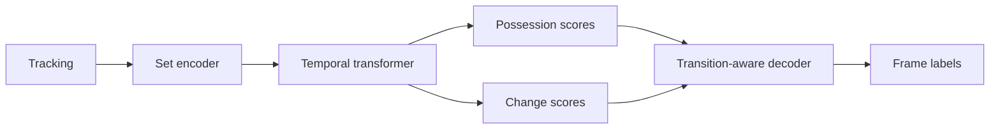

# N018 | Selected possession model

`best.pt` is the externally trained N018 model selected in the research record.
The team confirmed that the model may be shared for the competition. The file
does not include the challenge dataset; it contains model tensors, architecture
and training configuration, the selected step, and external validation metrics.

## Model at a glance

N018 uses a player-set encoder followed by a temporal transformer and a
possession-change head. Its inputs combine ball, player and team-context
features; a transition-aware decoder converts model outputs into `H`, `A`,
and `D` labels. The selected configuration has approximately 9.72 million
parameters, 256-dimensional embeddings, four spatial layers, eight temporal
layers, eight attention heads and 384-frame windows at 25 Hz.

## Evidence and limits

The three-match **external development audit** recorded spellF1 of **0.7673**
on clean inputs and **0.6166** on simulated degraded inputs, for a mean of
**0.6919**. The corresponding macroF1 values were **0.9311** and **0.8890**.
The audit was reused during development, so it is not an independent final
test. N018 was promoted on a single seed; second-seed confirmation was waived.
The private competition score is not available before official evaluation.
See the [promotion record](../../experiments/research/decisions.md).

## Frozen inference assets

| Asset | Purpose |
|---|---|
| [`best.pt`](best.pt) | Selected model weights and configuration |
| [`n018_large_long.toml`](../../configs/neural/n018_large_long.toml) | Training configuration and data splits |
| [`n018_decoder.json`](../../configs/neural/n018_decoder.json) | Validation-selected inference decoder |

The frozen decoder uses team-switch penalty `2.0`, dead-ball switch penalty
`4.0` and transition gain `1.0`. Its values take precedence over the decoder
defaults in the training TOML for the recorded submission.

SHA-256: `1b42d0f7eab232f6ba4ea2131d3f0a892f41f750504789dfcd5ce5edb5158a81`

Use it with the frozen decoder at `configs/neural/n018_decoder.json` and the
inference instructions in the [repository README](../../README.md#getting-started).
The recorded output was regenerated in a clean checkout on the documented
Windows CUDA environment; results may differ across hardware. PyTorch checkpoints use
serialization capable of executing code when loaded; use only the reviewed file
from a trusted source. The challenge data has separate access and usage terms.
